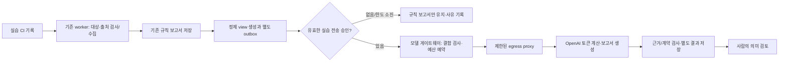

# B-06-M4 실습 상시 모델 연결 설계

상태: **2026-10-24 KST 설계와 [M5 로컬 모의 구현](B6-continuous-model-mock-implementation.md) 완료, [M6 비활성 배포 정의](B6-model-service-deployment.md) 준비·서버 API 형식 검증, 실제 배포·상시 전송 승인 전**. 현재 배포된 운영 worker와 실습 CI worker는 규칙 보고서만 만든다. [M3](B6-model-projection-live-comparison.md)의 한 입력에 대한 승인과 API 호출은 이 설계의 상시 전송을 승인하지 않는다. 다음 구현 순서는 M6 배포 검증→M7이며, [B 운영 평가](B6-operational-evaluation.md)은 계속 보류한다.

## 목적과 첫 적용 범위

첫 대상은 `ai-ci` worker가 조사하는 `ai-ops-lab/lab-api` 한 서비스다. CI 사건을 수집해 기존 규칙 보고서를 즉시 저장한 뒤, **별도 승인이 활성화된 기간에만** 정제한 관측값을 모델로 보내 보조 분석을 붙인다. 기존 규칙 결과와 원본 snapshot을 덮어쓰지 않는다. 경보 기반 운영 앱·production snapshot·임의 사용자 질문은 이 연결의 입력이 될 수 없다. 모델은 Kubernetes·Argo·GitHub 도구나 변경 권한을 받지 않는다.

### M4 설계 당시 코드와 연결 지점

| 위치 | 현재 사실 | M5에서 바꿀 부분 |
|---|---|---|
| `src/ai_ops/worker.py`, `job_queue.py` | CI worker는 `mode=rules`만 받고, 검증한 snapshot→규칙 보고서→큐 완료로 끝난다. 재시작 시 저장 보고서와 큐 참조를 대조한다. | **실습 CI 경로에서만** 완료된 규칙 run을 기준으로 정제 view와 outbox 참조를 영속화한다. 기존 큐 상태와 보고서 검증을 바꾸지 않는다. 완료 직후 중단되면 복구 과정에서 같은 outbox 키를 재구성한다. |
| `model_projection.py` | 실습 원본을 검증하고 허용 필드만 담은 view와 원본 대응표를 만든다. | 새 클러스터의 대상 UID·감사·snapshot 해시를 worker에서 검증해 사용한다. outbox에는 정제 view와 결합 해시만 싣고 원본 대응표는 기존 보호 저장소에 남긴다. |
| `model_comparison.py` | 개인 로컬 폴더, **정확한 입력 한 건**의 30분 승인, 단일 실사용 장부에 맞춰져 있다. | 순수 view/검증 기능은 재사용하되, 서버의 기간 제한 승인·중복 키·비용 장부는 별도 계약으로 만든다. 로컬 M3 승인 파일이나 개인 키 경로를 클러스터에 복사하지 않는다. |
| `projected_model_engine.py`, `projected_model_transport.py` | `gpt-6-sol/low`, 정형 출력, `store=false`, 토큰 계산·생성 각 1회와 보고서 인용 검사가 있다. 현재 HTTPS 전송은 운영자 개인 키 파일을 직접 읽는다. | 요청 계약과 검사 코드를 재사용한다. 클러스터 전송은 전용 Secret과 고정 proxy를 사용하는 별도 transport로 만든다. 모델/effort·프롬프트·가격 버전이 바뀌면 새 승인이 필요하다. |
| `b_contracts.py`, Helm `networkpolicy.yaml` | `BRuntime.llm_enabled=false`이며 운영 AI Pod는 내부 Kubernetes·Prometheus 경로만 나갈 수 있다. | 이 기본 차단은 유지한다. 실습 모델 서비스만 별도 namespace/서비스계정/NetworkPolicy를 사용한다. 운영 worker에 키나 인터넷 egress를 추가하지 않는다. |

## 전송 계약과 저장 경계

worker는 기존 `_load_snapshot`과 `validate_snapshot`을 통과한 실습 자료에서만 `captured-practice-projection-v1` view를 만든다. [M1 허용 필드](B6-model-data-policy.md)를 그대로 적용해 실제 Pod 이름·UID·IP·로그/이벤트 문장·CI artifact·DB/Redis URL·Secret·원본 해시 대응표는 모델 요청에서 제외한다. 누락·stale·권한 거부는 정상값으로 채우지 않고 원래 상태와 `excluded_by_model_policy` 개수를 보존한다. 원본 관측 시각은 UTC로 보존하고 화면에서만 KST로 표시한다.

outbox의 유일 키는 `source_run_id + snapshot_hash + view_hash + policy_version + campaign_id`의 정규화 해시다. 각 레코드는 source target UID, config/audit hash, 규칙 보고서 참조, view/template hash, 생성 코드 버전, 상태를 결합한다. 원본 대응표는 gateway에 전달하지 않는다. 기존 규칙 보고서가 partial이어도 view에 포함된 available 근거만 모델이 인용할 수 있다. 정제 실패는 `projection_rejected`로 별도 기록하며 규칙 보고서를 실패로 바꾸지 않는다.

모델 결과는 원본 사건·run과 outbox 키로 연결하는 **별도 보조 기록**이다. 같은 view의 `rules_projection(view)` 요약도 함께 저장해 모델과 동등 입력으로 비교한다. 기존 전체 snapshot 규칙 보고서는 별도로 유지하며, 이를 동등 입력의 규칙 결과라고 부르지 않는다. `ProjectionAnalysisReport`의 input hash와 available ID 인용을 재검사한다. 계약 통과만으로 서술이 참이라는 뜻은 아니므로 모델 결과는 `needs_review/semantic_review_required`로 게시하고 사람이 의미를 확인한 뒤에만 검토 완료로 표시한다. 장애 원인 후보·후속 조치는 제안이며 실행 상태는 항상 `not_executed`다. 기존 규칙 보고서 조회와 알림 전달은 모델 결과를 기다리지 않는다.

## 상시 전송 승인과 비용

M3의 승인 방식은 미래에 들어올 자료의 **실제 내용**을 사용자에게 보여주지 못한다. 따라서 첫 실습 자동 전송에는 별도의 **기간·범위 제한 캠페인 승인**이 필요하다. 승인 화면에는 샘플 view, 앞으로 허용되는 필드/제외 필드, 대상 namespace·Deployment UID, 정책/코드/프롬프트/모델/가격 버전, 목적지, 보관, 예상 최대 전송 건수와 비용을 표시한다. 미래 각 입력의 내용이 승인 시점에는 알려지지 않는다는 점도 명시한다. 승인자는 이 제한된 범위의 자동 전송을 명시적으로 선택한다. 배포·복구 변경 권한은 여기에 포함되지 않는다.

첫 캠페인 설계 상한은 **24시간, 생성 최대 10건, 건당 $0.10 예약, UTC 하루 $1**이다. 이 숫자는 M1/M3의 비용 상한을 유지하는 제안이며 실제 캠페인을 켜기 전에 사용자에게 구체적 승인안을 제시한다. token-count 요청도 외부 전송이므로 캠페인 검증과 예약 뒤에만 호출한다. 모델 또는 API 가격 확인 날짜가 7일을 넘거나, UID·허용 필드·프롬프트·키 지문·목적지가 달라지면 캠페인을 멈추고 새 검토를 요구한다. 별도 로컬 M3 도구를 같은 API 계정으로 동시에 쓰면 장부가 분리될 수 있으므로 첫 캠페인 동안 로컬 live 실행을 중지하거나 공통 예산 권한으로 묶어야 한다. API 계정/프로젝트의 실제 청구액은 로컬 예약액과 구분한다.

게이트웨이의 단일 영속 장부가 UTC 날짜별 예약과 캠페인 건수를 잠금 아래 원자적으로 기록한다. `prepared → approved → reserved → sending_token_count → sending_generation → needs_review/completed/failed` 상태를 사용한다. HTTP 요청이 나갔을 수 있는데 응답을 잃으면 `needs_review/unknown_send`로 멈추고 **자동 재전송하지 않는다**. 같은 outbox 키가 다시 들어와도 기존 상태/결과만 돌려준다. 이는 네트워크를 가로지르는 완전한 exactly-once 보장이 아니라 보수적인 재시도 차단이다. 사용량이 없으면 0달러로 기록하지 않고 예약액과 청구 미확정을 남긴다.

승인 없음·만료·예산 초과·서버 장애·계약/의미 검사 실패 때 규칙 보고서는 계속 제공한다. 모델 결과 상태와 실패 이유는 별도 표시한다. 운영 중지는 새 outbox 처리와 egress를 차단하되 이미 시작한 불명확한 요청을 성공이나 비용 0으로 바꾸지 않는다. 정제 입력·결과 본문과 대응표는 7일, 본문 없는 예산/중복 기록은 90일을 기본으로 하며 스케줄 정리와 중단/복구 시험을 구현해야 한다.

## 자격·네트워크·배포 구조

`ai-ci` worker는 현재 실습 대상 읽기 권한과 큐 PVC만 사용한다. 모델 전용 gateway는 **원본 snapshot PVC·Kubernetes API 토큰·GitHub 자격을 갖지 않고**, 승인된 view만 내부 요청으로 받는다. worker와 gateway 사이에는 별도 서비스 인증 자격, namespace/Pod 선택 NetworkPolicy, 요청 크기·정형 계약·서명/해시 검사를 둔다. gateway에만 OpenAI 전용 Kubernetes Secret을 마운트하고, Secret 원문은 로그·보고서·CI artifact에 넣지 않는다. 실습과 운영 자격은 공유하지 않는다.

gateway가 인터넷에 직접 연결되지 않도록 고정 `api.openai.com:443`만 허용하는 egress proxy를 둔다. proxy는 CONNECT 목적지·포트·DNS 해석을 검사하고 임의 IP/호스트·redirect를 거부한다. gateway는 proxy를 통해 TLS 서버 인증을 끝까지 검증하며 API 키는 proxy 설정이나 URL에 넣지 않는다. 기존 direct `http.client` transport가 proxy를 지원하지 않으므로 전용 구현과 검증이 필요하다. gateway/worker에 다른 외부 egress가 남아 있지 않은지 Pod 내부에서 허용/거부를 확인한다. proxy 구현과 정책이 준비되기 전에는 live 모델 기능을 활성화하지 않는다.

새 구성은 기본 `enabled=false`, 복제수 0, 별도 암호화 PVC와 제한된 서비스계정으로 배포한다. 활성화에는 검토된 이미지 digest·Secret 유효성·캠페인 승인·네트워크 검증을 모두 요구한다. 재설치/정리 자동화에는 gateway·proxy·Secret·PVC/PV/EBS와 캠페인 정리 순서를 추가한다. Terraform state와 Route53 처리 범위도 기존 수명주기 문서에 맞춘다. **이 설계 문서 작성만으로 키를 클러스터에 넣거나 egress를 열지 않는다.**

공식 OpenAI 문서에 따르면 Responses의 저장은 기본 활성이고 `store=false`로 응답 저장을 끌 수 있지만, 기본 악용 감시 로그는 고객 내용을 포함할 수 있으며 통상 최대 30일 보관된다. 캠페인 준비 시 계정의 선택적 데이터 공유 설정과 실제 보관 조건을 다시 확인한다. 현재 모델의 표준 텍스트 단가는 100만 토큰당 입력 $2·출력 $10이며, 실제 청구/가격은 활성화 직전에 재확인한다. [Responses 저장](https://developers.openai.com/api/docs/guides/conversation-state), [API 데이터 제어](https://developers.openai.com/api/docs/guides/your-data), [GPT-6 Sol 모델·가격](https://developers.openai.com/api/docs/models/gpt-6-sol).

## 구현 순서와 통과 기준

| 순서 | 작업 | 완료 증거 |
|---|---|---|
| **B-06-M5 · 로컬 완료** | CI worker의 완료 run→정제 view/outbox, 기간 모의 승인·예산/중복 장부, 별도 보조 결과 저장을 **모의 transport**로 구현했다. 현재 main의 CI 소스와 로컬 M3 변경을 결합했고 기존 S9/S11 코드도 보존했다. | production·다른 UID·원문/민감 필드 거부, 규칙 결과 불변, 재시작/중복/불명 전송·UTC 예산·보관/중지 집중 시험과 전체 Python 439개 통과. 새 실호출 0회. [기록](B6-continuous-model-mock-implementation.md) |
| **B-06-M6 · 진행 중** | 비활성 gateway/proxy·Secret 경로·암호화 PVC·NetworkPolicy를 이미지/배포 코드에 추가하고 설치/정리 순서를 연결했다. 새 코드 포함 승인 이미지와 실제 적용·Pod 네트워크 실측은 남았다. | 기존 namespace 대입 사본의 서버 dry-run, 코드 경계 시험은 통과했다. 새 이미지·실제 적용 후 Pod 자격 분리, 내부 요청만 허용·직접 외부/임의 호스트 거부, worker/기존 알림 정상 검증이 필요하다. 승인 전 gateway 복제수 0·API 호출 0회. |
| **B-06-M7** | 실제 표시될 캠페인 승인안을 제시하고 승인된 실습 범위에서만 활성화한다. 정상 관측의 자료 부족 1건과 제한된 장애 관측 1건을 필요한 만큼 실행한다. | 동일 view의 규칙/모델 근거·오진·제외 자료·partial/unknown·미실행 제안 검토, 중복·중단·한도·정리·중지 확인. 의도적 유료 429/timeout 반복은 모의 시험으로 대체. 종료 때 B/C 판정을 다시 기록. |

M7에서 정상/장애 두 사례만으로 일반 진단 정확도, MTTR 개선, 운영 production 모델 분석을 주장하지 않는다. 현재 M3의 원인 후보 0개와 `unknown`은 자료 부족 사례의 올바른 제한이며, 새 경로에서 근거가 충분해지는지 여부는 별도 관측과 사람 검토로 판단한다. 다음 작업은 **B-06-M6 새 이미지·기본 비활성 적용 및 네트워크 실측**, 권장 추론 깊이는 **GPT-6 SOL high**다.
