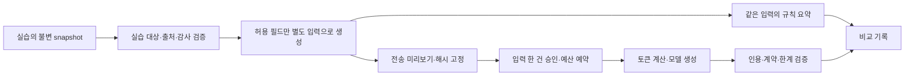

# B-06-M1 실습 수집 자료의 모델 비교 정책

상태: **2026-10-23 KST M1/M2 완료, M3 승인된 실제 입력 한 건의 비교·자체 검토 완료**. [구현 기록](B6-model-projection-implementation.md)을 참고한다. 아래는 M1에서 정한 설계이며 실제 API 연결·자료 반출/비교는 M3 범위다. 이 문서는 전송할 자료와 처리 경계를 정한 설계이며, 특정 자료의 외부 전송 승인이나 클러스터 모델 활성화 기록이 아니다.

## 무엇을 만들고 어떤 순서로 동작하는가

이미 동작하는 실습 수집기에서 고정한 자료 중, 모델 비교에 필요한 상태·설정 여부·집계 지표만 골라 별도 입력으로 만든다. 운영자가 실제 전송될 내용을 확인하고 그 입력 한 건을 승인하면, 같은 정제 입력으로 규칙 요약과 모델 보고서를 비교한다. 모델은 클러스터를 직접 조회하거나 변경하지 않는다.



`snapshot`은 특정 시점에 수집해 내용과 해시를 고정한 자료다. `projection`은 그 자료에서 명시적으로 허용한 필드만 뽑아 새로 만든 입력이다. 원본 자료를 합성 자료로 바꾸거나 출처 표시만 고치는 방식은 사용하지 않는다. `approval`은 전송할 입력·모델·목적지·비용 한도를 묶은 일회성 승인 기록이다.

## 현재 코드에서 확인한 제약

아래 파일명은 `ai-ops/` 기준이며, 현재 main `ef7a005475a432be0881c818efa9dd4f3e032694`의 구현을 확인했다.

| 현재 파일 | 확인한 동작 | 이번 설계의 연결 방향 |
|---|---|---|
| `src/ai_ops/data_policy.py` | `synthetic-only-v1`, practice라도 captured 항목이 있으면 모델 전송 거부 | 이 기본 검사를 보존하고, 별도의 승인된 정제 입력만 새 진입점에서 허용한다. |
| `src/ai_ops/b_contracts.py` | `BRuntime.llm_enabled`는 `Literal[False]` | 기존 운영·실습 worker 설정을 바꾸지 않는다. 첫 비교는 수동 운영자 도구로 분리한다. |
| `src/ai_ops/incidents.py` | captured snapshot은 내장 규칙 분석만 허용하고 기존 보고서를 버전별로 재검증 | 원본 조사·저장·재조회 경로를 유지하고 비교 결과는 별도 저장한다. |
| `src/ai_ops/replay_tools.py` | 종류별 항목을 원래 payload와 함께 반환 | 원본 bundle을 이 도구에 연결하면 허용하지 않은 필드가 나갈 수 있다. 첫 비교에서는 동적 도구를 제공하지 않는다. |
| `src/ai_ops/openai_engine.py` | Responses 어댑터·정형 출력·`store=false`·추정 비용, 기본 `reasoning.effort=low` | 전송 함수·사용량/오류 분류 등의 공통 기능만 분리해 재사용한다. 기존 합성 분석기를 그대로 호출하지 않는다. |
| 같은 파일의 `_http_count_input_tokens` | 입력과 프롬프트를 `/responses/input_tokens`에 전송 | 토큰 계산도 외부 전송이다. 승인·전송 검사·예산 예약 이전에는 호출하지 않는다. |
| `src/ai_ops/path_policy.py`, `retention.py` | 지정 파일 경계, 기존 결과 덮어쓰기 거부, 운영 큐 자료의 7일 정리 | 새 비교 자료에도 경로 제한·비공개 권한·독립 보관 기한을 연결해야 한다. 기존 운영 정리가 자동으로 처리한다고 가정하지 않는다. |

문서의 제안 파일·타입·명령은 아래 구현 계획이며 현재 존재하는 기능으로 해석하지 않는다. 이번 작업은 코드·Secret·NetworkPolicy·예산 설정을 변경하지 않았다.

## 첫 비교 대상과 범위

첫 입력은 **S6의 제한된 읽기 관측 사례 1건**이다. 새 장애를 주입하지 않고 현재 실습 수집기로 한 번 고정한 자료를 사용한다. Pod Ready와 캐시 계수 등을 설명하되, 부족한 사용자 경로 근거만으로 정상 서비스나 복구 완료를 단정하지 않는지 본다. 이 한 건으로 S6 전체 정상 진단 품질을 완료 처리하지 않는다.

| 구분 | 결정 |
|---|---|
| 원본 대상 | cluster `urlshortener`, environment `practice`, namespace `ai-ops-lab`, Deployment·Service `lab-api`의 정확한 조합 |
| 원본 출처 확인 | 현재 클러스터 식별자·실습 Deployment UID·등록 binding/config hash·수집 감사·snapshot hash를 검사한다. 같은 이름의 재설치 대상은 UID가 달라 별도 자료다. |
| 제외 대상 | production·운영 namespace, 다른 실습 대상, 복수 대상 혼합, 출처/해시 불일치, 임의 파일·URL로 준 자료 |
| 실행 위치 | 첫 비교는 운영자 로컬의 별도 도구. 원본 snapshot 검증과 필드 선별은 검토한 exporter를 실습 수집기 안에서 실행하고, 선별 결과만 반출한다. 원본 로그·snapshot 전체를 로컬로 복사하지 않는다. |
| 모델 | 기존 `gpt-6-sol` API 키 경로. 첫 비교의 effort는 현재 어댑터와 같은 `low`로 명시해 고정한다. 작업 수행 에이전트에 권장하는 high와 별개다. 모델·effort 변경은 새 승인/비교 조건이다. |
| 비교 횟수 | 승인 입력 1건에 생성 요청 최대 1회. 자동 경보·상시 CI worker에 연결하지 않는다. |
| 첫 모델의 기능 | 전체 허용 입력을 한 번에 받는 정형 보고서 생성. 함수 호출·shell·MCP·검색·파일 조회·실시간 수집 도구 없음. |

수집기 안에서 원본을 검증할 수 없거나 승인된 exporter 코드/이미지를 확인하지 못하면 준비 실패로 끝낸다. 샘플 파일이나 정답 기록으로 대체해 실측 성공으로 표시하지 않는다. 원본 수집 자료의 작성 시각과 분석 실행 시각을 구분하고, 실행 시점의 최신 상태를 다시 확인한 것처럼 서술하지 않는다.

## 허용 필드와 반출 금지 필드

필드 허용 목록으로 새 객체를 만든다. 정규식 마스킹은 추가 검사이며, 모든 개인정보를 제거했다는 보증으로 사용하지 않는다. 알 수 없는 필드·형식·enum은 전송을 거부한다.

| 종류 | 첫 입력에 허용 | 제외·거부 |
|---|---|---|
| 대상·식별 | 실행 안에서만 일관된 `cluster-1`, `service-1`, `pod-1` 별칭, 별도 `ev-view-001` 형태 증거 ID | 실제 클러스터/namespace/Pod 이름·UID·IP·Endpoint·계정 ID·리소스 ARN·원래 source_ref |
| 관측 시각 | 검증된 UTC window·observed_at·collected_at, 수집 완료 시각 | 원시 timestamp 문자열·오프셋의 중복 원문. 시각을 현재로 옮기거나 임의 생성하지 않음 |
| workload 상태 | phase의 유한 값, ready boolean, 0 이상 restart 수, 관측된 Pod 수 | image 전체 문자열, 환경변수·label/annotation 전체, 노드/registry 식별자 |
| 설정 요약 | `cache_intended_enabled`, `redis_url_configured`, 검증된 `read_engine_role` enum | 실제 Redis/DB URL·비밀번호·Secret 이름/값·인증서·연결 문자열 |
| 지표 | 등록된 `query_id`, 고정 route/operation enum, unit, 유한 숫자 표본, 관측 시각과 scrape 품질/표본 부족 표시 | 임의 PromQL·label·실제 URL 경로 값·NaN/Infinity·출처 불명 집계. 요청 수/분모 없이 0이나 정상으로 보정하지 않음 |
| 자료 상태 | available/missing/permission_denied/stale/invalid 및 고정 reason code, 정책상 제외한 종류/개수 | available이 아닌 payload, 원문 오류, 미검증 값을 정상 근거로 승격 |
| 로그·이벤트·배포/CI | 첫 버전은 해당 종류의 제외 개수와 고정 제외 사유만 표시 | 로그 행·이벤트 자유 문장·Git URL/SHA·CI artifact·배포 원문·이미지 digest/태그·Ground truth·복구 계획 |
| 질문·런북 | 코드에 고정해 검토한 질문·프롬프트·출력 스키마 | 사용자 자유 질문·전체 런북 본문. 첫 버전은 런북 도구도 제공하지 않음 |

source의 로그/이벤트를 제외하면 이미지 원인 진단 등 일부 기능이 제한된다. 제외 사유는 `excluded_by_model_policy`로 기록하되 원래 수집 상태와 구분한다. 예를 들어 원본 available 이벤트를 source missing으로 바꾸지 않고, `source_status=available`, `projection_status=excluded`로 남긴다. 모델에게는 종류별 제외 개수와 한계를 전달한다.

모델에 보내는 새 입력의 출처는 `captured_projection`이다. 기존 `EvidenceBundle`의 provenance enum을 억지로 바꾸지 않고 별도 계약을 만든다. local mapping은 view 증거 ID와 원본 증거 ID·hash의 관계를 검증용으로 보관하며 외부로 보내지 않는다. 원본 bundle/hash/audit는 수정하지 않는다.

다음은 **구조를 설명하는 가상 예**이며 실제 실측 자료나 구현된 스키마가 아니다.

```json
{
  "schema_version": 1,
  "policy_version": "captured-practice-projection-v1",
  "origin_kind": "captured_projection",
  "target_alias": "service-1",
  "items": [
    {
      "evidence_id": "ev-view-001",
      "kind": "workload_status",
      "source_status": "available",
      "projection_status": "included",
      "payload": {"pod_alias": "pod-1", "phase": "Running", "ready": true, "restarts": 0}
    }
  ],
  "excluded": [{"kind": "log", "count": 1, "reason": "excluded_by_model_policy"}]
}
```

실제 계약에는 위 표의 UTC 시각·window·collection 품질·hash 결합 필드를 필수로 넣는다. 예시의 일부 필드 생략을 실행 코드의 허용 근거로 삼지 않는다.

## 승인과 요청 내용의 고정

원본 snapshot과 local mapping, 정제 입력, 모델에 전달할 고정 프롬프트/출력 스키마를 분리한다. `model_view_hash`는 정제 입력의 canonical JSON SHA-256이며, 실제 HTTP 요청 두 종류의 template/hash도 고정한다. 토큰 계산 요청은 생성 요청에서 지원하는 필드만 선택해 만들고 두 요청 모두 같은 승인된 입력·지시문을 사용한다.

전송 미리보기는 모델에 나갈 **실제 내용 전체**, 포함/제외 항목, 출처 시각, 모델·effort·목적지, 출력/크기/시간/횟수·비용 상한과 보관 조건을 표시한다. 원본 자료를 추가로 표시하는 화면은 아니다. API 키는 전송 본문 밖 인증 헤더에서만 사용하며 미리보기에 넣지 않는다.

승인 기록은 source bundle/audit/config hash·현재 대상 UID 검증값·view/mapping hash·정책 버전·프롬프트/스키마/전송 코드 버전·두 요청 template hash·모델/effort·목적지·한도·승인자·만료 시각을 결합한다. 승인 유효 시간은 **30분**, 생성 요청 사용 횟수는 **1회**다. 승인 후 내용/모델/상한이 바뀌거나 출처를 재수집하면 새 미리보기와 승인이 필요하다. 입력 시각을 최신으로 바꾸지 않는다.

흐름은 `prepared → approved → reserved → sending → completed/failed/needs_review`다. 승인 확인과 생성 요청 사용 처리는 잠금·영속 기록으로 수행해 재실행의 중복 전송을 막는다. 전송 뒤 응답이 불명확하면 needs_review로 남기며 자동 재요청하지 않는다. 이전 성공 결과 조회는 API를 부르지 않는다. 승인은 외부 데이터 전송/비용 승인일 뿐 C단계의 배포 수정 승인이 아니다.

이것은 운영자 로컬 프로세스의 오사용·입력 교체·재전송 방지 경계다. 같은 OS 계정의 관리자나 파일 변조 권한을 가진 주체까지 막는 별도 보안 시스템으로 주장하지 않는다. 설계 진행 요청이나 기존 API 키 저장, 과거 합성 입력 호출 승인은 이 실제 입력 한 건의 전송 승인이 아니다.

## API 호출·비용·보관 조건

| 항목 | 첫 비교의 설계값 |
|---|---|
| API 경로 | `https://api.openai.com:443/v1/responses/input_tokens` 최대 1회, `/v1/responses` 생성 최대 1회. 나머지 외부 경로·redirect 거부 |
| 입력 | 정제 view 최대 64개 항목. 프롬프트/스키마까지 포함한 생성 요청 전체 canonical JSON 최대 32,000바이트. 초과하면 거부하며 조용히 자르거나 한도를 늘리지 않음 |
| 생성 | `store=false`, background 사용 안 함, conversation/previous_response_id 사용 안 함, tools 없음, JSON Schema로 보고서 구조 제한 |
| 토큰·시간 | 출력 상한 1,024토큰, 각 HTTP 요청 timeout 30초, 전체 전송 단계 60초. 네트워크 자동 재시도 없음 |
| 예산 | 건당 $0.10·UTC 하루 $1. A7 개발 예약 한도 $30과 별도. 첫 외부 요청 전 $0.10 보수적 예약, 실패해도 자동 환급하지 않음 |
| 비용 계산 | M3 전에 가격 기준일·단가·모델 호환성을 재확인한다. 현재 코드의 2026-09-30 단가를 최신 가격으로 간주하지 않는다. 토큰 계산 뒤 입력 비용+최대 출력 비용이 건당 한도를 넘으면 생성하지 않음 |
| 사용량 불명 | 응답 없는 호출은 0달러로 기록하지 않음. 알려진 usage·추정 비용·예약액·불명 여부를 나누고 실제 청구액과 구분 |
| 로컬 저장 | Git 밖 전용 폴더, 0700 디렉터리/0600 파일. 정제 입력·mapping·승인·검증된 보고서·audit는 생성 시점 기준 7일. 운영자 도구에 만료 미리보기/연계 삭제를 구현해야 하며 현재 자동 정리된다고 주장하지 않음 |
| 예산 장부 | 비교 도구의 단일 고정 저장소에서 UTC 일별 잠금·예약 관리. 일반 자료 정리로 당일 예약을 지우지 않음. 본문 없는 비용 장부는 90일 보관 후 별도 정리 |
| 공개 결과 | 필드 목록·정책/코드 버전·상태·시간·비용·품질 집계만 문서화. projection·mapping·키·원문 응답은 Git/CI artifact/로그에 넣지 않음 |

OpenAI 공식 문서는 Responses 응답의 기본 저장과 `store=false`로 해당 저장을 끄는 방법을 설명한다. 이 옵션을 공급자 보관 전체가 없다는 뜻으로 해석하지 않는다. [Conversation state](https://developers.openai.com/api/docs/guides/conversation-state).

API 데이터는 명시적 opt-in이 없으면 학습에 사용되지 않지만, 기본 abuse monitoring 로그는 고객 내용을 포함할 수 있고 통상 최대 30일 보관된다. ZDR 등의 별도 승인을 이 계정에 적용됐다고 가정하지 않는다. 전송 전 계정 데이터 공유/보관 설정도 확인해야 한다. [Data controls](https://developers.openai.com/api/docs/guides/your-data). 이 확인만으로 개인정보를 전송해도 된다는 의미는 아니다.

처음에는 로컬 전용 비교이므로 기존 worker의 NetworkPolicy를 풀거나 API 키를 클러스터에 넣지 않는다. 프로세스에는 AWS/Kubernetes/GitHub 도구를 모델 기능으로 제공하지 않는다. 운영자 계정의 파일 권한 자체를 OS sandbox로 주장하지 않는다. 향후 상시 클러스터 연결은 기존 통합 계획의 전용 egress proxy·컨테이너별 자격·직접 인터넷 우회 차단을 별도 구현/검증한 뒤 진행한다.

## 규칙과 모델 비교를 어떻게 채점하는가

같은 정제 view를 입력으로 하는 작은 `rules-projection-v1` 요약기를 만든다. 포함된 상태·설정·지표의 확인 가능한 사실과 제외/부족 자료만 설명한다. 기존 전체 snapshot 규칙 보고서는 참고 자료로만 보관한다. 전체 자료를 본 기존 규칙과 적은 자료를 본 모델을 “동일 입력 비교”라고 부르지 않는다.

모델 결과도 별도의 `ProjectionAnalysisReport` 계약으로 검증하고, 원본 IncidentStore의 input_hash나 기존 보고서를 교체하지 않는다. 보고서의 input_hash는 view hash이며 mapping으로 원본 사건/run과 관계를 추적한다. 포함된 available view ID만 사실/가설의 근거가 될 수 있다. 실행 제안은 모두 `not_executed`이고 첫 제한 관측의 current_state는 `unknown`을 유지한다. 모델의 자연어 내용이 사실인지까지 JSON Schema가 보장한다고 주장하지 않는다.

| 항목 | 첫 한 건의 통과 기준 |
|---|---|
| 동등 입력 | 규칙/모델의 view hash·정책·원본 snapshot 연결이 같음 |
| 근거 | 인용 ID가 실제 포함·전달된 available 항목이고 서술과 맞음 |
| 설명 | Ready·캐시 의도·미설정 여부·관측된 지표를 조건과 시각 한계 안에서 설명 |
| 오진 방지 | 정상 miss·자료 누락을 장애로 단정하지 않고, 불충분한 근거의 가설은 실패로 기록 |
| 제외 자료 | 로그/이벤트/CI를 보지 않았음을 밝히고 없는 내용을 인용하지 않음 |
| 조치·현재 상태 | 실행 완료·현재 서비스 정상·복구 완료를 주장하지 않음 |
| 비용·운영 | 요청 횟수·시간·사용량·예약/추정 비용과 실패 사유 기록, 기존 worker/보고서 영향 없음 |

계약은 통과했지만 의미가 틀리면 `needs_review`다. 모델 실패는 별도 실패 기록으로 남기고 기존 규칙 보고서를 AI 성공으로 이름만 바꾸지 않는다. 규칙 결과는 계속 사용할 수 있다. 한 사례의 차이는 관찰 결과이며 정확도·오탐률·MTTR 개선률로 일반화하지 않는다. 전체 S1~S11 재실험은 하지 않으며, 새 결함·정책 변경에 직접 필요한 경우에만 해당 사례를 추가한다.

## B-06-M2의 파일별 구현 순서

아래 파일은 **신규 제안**이다. 검토 과정에서 이름이 바뀌면 작업 리스트와 이 표를 함께 고친다.

| 순서 | 파일/기능 | 구현·검증 범위 |
|---|---|---|
| 1 | `src/ai_ops/model_projection.py` | 별도 view·private manifest/mapping 계약, 정확한 실습 대상·감사·허용 필드·UTC/별칭/해시 생성. source 검증과 모델 view 검증을 구분 |
| 2 | `scripts/prepare_model_projection.py` | 검토된 exporter의 실습 내부 실행·정제 결과만 반출·로컬 미리보기 생성. 임의 namespace/path/원본 반출 거부 |
| 3 | `src/ai_ops/model_comparison.py` | 일회 승인·고정 예산 장부·변조/중복 차단·같은 view 규칙 요약·비교 결과·만료 연계 삭제 |
| 4 | `src/ai_ops/projected_model_engine.py` | 승인된 view 전용 정형 출력. A5 전송/사용량 분류 공통 기능 재사용, 토큰 계산도 승인 뒤 실행. 기존 A5 합성 gate 보존 |
| 5 | `scripts/compare_model_projection.py` | preview/approve/run/show/purge 등 운영자 단계 연결. 별도 실행 키·source/view hash·상태 표시. API 키는 기존 비공개 파일 경로를 명시적으로 읽되 내용은 출력 안 함 |
| 6 | 필요한 경계 시험 | production·다른 UID·혼합/변조·미승인·승인 만료·입력/비용 초과·중복/불명 전송·허위 인용·민감 필드 sentinel·동일 view·기존 captured 차단을 모의 transport로 검증 |

M2의 완료는 **외부 호출 없는 구현과 모의 검증**까지다. M3에서 실제 선별 입력의 미리보기가 준비되면 그 내용을 근거로 전송 승인·계정/보관/가격 조건을 확인하고 한 건만 실행한다. 사용자에게 추상적인 전송 승인을 먼저 요구하지 않는다. 배포·GitHub 이미지 등록·새 인프라 생성은 M2의 필수 작업이 아니다.

## 이번 단계의 완료와 미실행 사항

정확한 실습 대상, 필드 허용/제외, 출처 보존, 미리보기·승인 결합, API/토큰 계산 경계, 비용·보관·모의 시험·동일 입력 비교 및 파일별 구현 순서를 정했다. **B-06-M1 설계 완료**로 표시한다.

실제 projection 생성·API 호출·모델 과금·클러스터 변경·새 장애 주입은 수행하지 않았다. 현재 `synthetic-only-v1`·`llm_enabled=false`는 그대로다. B 완료·C단계 진입은 보류한다. 다음 작업 **B-06-M2**, 권장 GPT-6 SOL high.

## B-06-M2 구현 후속 — 2026-10-23

[구현 기록](B6-model-projection-implementation.md)에 새 계약·실습 내부 exporter·비공개 고정 저장·일회 승인/모의 예산·단일 요청 어댑터·같은 view 규칙/보고서·기한 정리를 구현했다. 신규 24개/최신 main 기반 전체 398개 시험과 기존 배포 경계 검사가 통과했다. 실제 수집 자료 반출·API·키 조회·과금·클러스터 변경은 하지 않았다. execution_mode=mock만 허용하며 실사용은 새 미리보기/승인/transport가 필요하다. 원본 snapshot에 상세 scrape 표본 수가 보관되지 않은 한계는 명시적으로 표시한다. 다음 B-06-M3, 권장 GPT-6 SOL high.


## M3 실제 입력 준비 — 2026-10-23

[실제 비교 준비 기록](B6-model-projection-live-comparison.md)에 실제 exporter·정제 입력 전체 미리보기·고정 목적지 전송·mock/live 예산 분리·계정/보관 확인을 구현하고 검증했다. API 호출과 실사용 예약은 없으며, 실제 전송은 준비된 입력 한 건의 승인과 계정 공유 꺼짐 확인 후 진행한다. 기존 M1/M2의 미실행 기록은 각 시점의 이력이다.


## M3 승인 후 실제 비교 — 2026-10-23

준비한 입력의 진행 승인과 사용자 공유 꺼짐 확인 후 토큰 계산 1회·생성 1회를 실행했다. 계약·같은 view 내용 자체 검토·원본 보존을 확인했다. [결과와 제한](B6-model-projection-live-comparison.md)을 참고한다. 이전 미실행/승인 대기 문장은 해당 준비 시점 기록이며, 클러스터 worker 모델 활성화는 하지 않았다.
